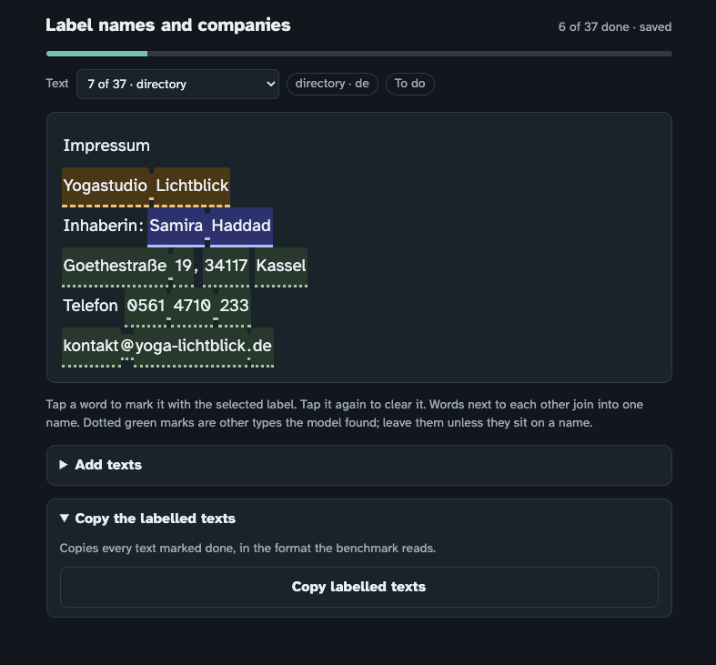
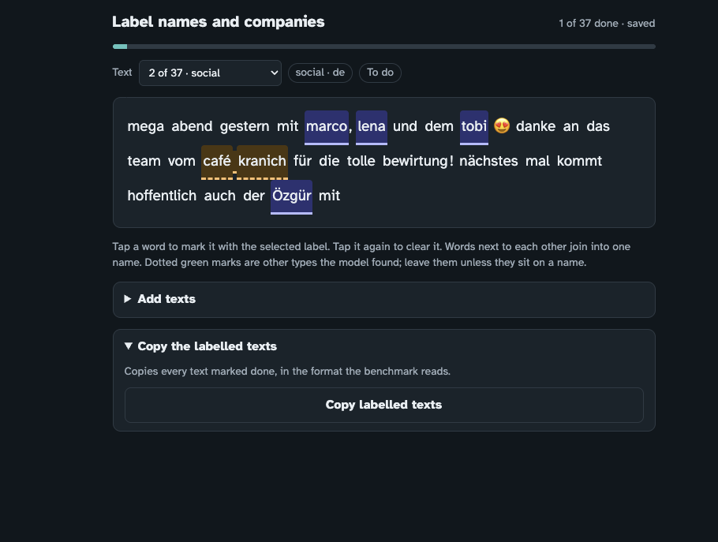

# betterprivacy-tarnkappe

Fast, small detection of personal data (PII) in English and German text, built for
[BetterPrivacy](https://betterprivacy.me).

*Tarnkappe* is the cloak of invisibility from German legend. This library finds the personal
data in a text so it can be flagged or hidden.

- **Fast:** about 1.4 ms per short text on one CPU core. No GPU.
- **Small:** 5 MB model plus 25 MB of word vectors. Three runtime dependencies (`numpy`, `onnxruntime`, `phonenumbers`).
- **Private:** runs locally; text is processed in memory and never logged or stored.
- **Open:** code, weights, training script and benchmark are all in this repository.

> **Status: v0.3 in development, prototype.** Good for its size and on edited text, weak on informal text,
> and not yet at its own [release bar](#release-bar). Read [Limits](#limits) before relying on it.

## What it detects

| Type | Found by | Example |
| --- | --- | --- |
| `FIRST_NAME`, `LAST_NAME` | model, then a splitting rule | Laura, Becker |
| `ORGANIZATION` | model | Nordwind GmbH |
| `STREET`, `LOCATION` | model | Hauptstraße 12, Köln |
| `ZIP` | country patterns next to an address part, plus the model | 50667, NW1 6XE |
| `PHONE` | Google's libphonenumber (`phonenumbers`), patterns, plus the model | +49 30 1234567, 0171 3920045 |
| `EMAIL` | pattern | laura@nordwind.de |
| `IBAN` | pattern + mod-97 checksum | DE89 3704 0044 0532 0130 00 |
| `CREDIT_CARD` | pattern + Luhn checksum | 4111 1111 1111 1111 |
| `IP_ADDRESS` | pattern (IPv4) | 192.168.0.12 |

## Quick start

```bash
pip install "git+https://github.com/ncserny/betterprivacy-tarnkappe"
```

The model files come with the package (about 30 MB). For the HTTP API add the extra:
`pip install "tarnkappe[api] @ git+https://github.com/ncserny/betterprivacy-tarnkappe"`.

### In Python

```python
from tarnkappe import Detector

detector = Detector()

detector.detect("Call Thomas Weber on +49 30 1234567")
# [{'type': 'FIRST_NAME', 'start': 5, 'end': 11, 'score': 1.0, 'source': 'model', 'text': 'Thomas'},
#  {'type': 'LAST_NAME',  'start': 12, 'end': 17, ...},
#  {'type': 'PHONE',      'start': 21, 'end': 35, 'score': 1.0, 'source': 'regex', ...}]

detector.redact("Call Thomas Weber on +49 30 1234567")
# 'Call [FIRST_NAME] [LAST_NAME] on [PHONE]'
```

`detect(text, min_score=None, split_names=True)`: by default each entity type uses its own threshold from
`tarnkappe/model/thresholds.json`, tuned to favour finding PII over avoiding false alarms. Pass `min_score` (0 to 1) to use one
threshold for all types: higher flags less, lower flags more. With `split_names=False` people are returned as one `PERSON` entity.

National phone formats are recognised for Germany, Austria, Switzerland, the UK and the US by default
(`Detector(phone_regions=("DE", "FR", ...))` changes that); international `+..` numbers always are.

### As an HTTP API

```bash
uvicorn tarnkappe.api:app --port 8000
# or, from a clone: docker build -t tarnkappe . && docker run -p 8000:8000 tarnkappe
```

```bash
curl -s localhost:8000/v1/detect -H 'content-type: application/json' \
  -d '{"text": "Hi, I am Laura Becker from Nordwind GmbH, laura@nordwind.de", "redact": true}'
```

```json
{
  "has_pii": true,
  "entities": [
    {"type": "FIRST_NAME",   "text": "Laura",             "start": 9,  "end": 14, "score": 0.9998, "source": "model"},
    {"type": "LAST_NAME",    "text": "Becker",            "start": 15, "end": 21, "score": 0.9998, "source": "model"},
    {"type": "ORGANIZATION", "text": "Nordwind GmbH",     "start": 27, "end": 40, "score": 0.9484, "source": "model"},
    {"type": "EMAIL",        "text": "laura@nordwind.de", "start": 42, "end": 59, "score": 1.0,    "source": "regex"}
  ],
  "redacted": "Hi, I am [FIRST_NAME] [LAST_NAME] from [ORGANIZATION], [EMAIL]",
  "took_ms": 1.2
}
```

| Endpoint | Body | Returns |
| --- | --- | --- |
| `POST /v1/detect` | `text` (up to 100,000 characters), optional `redact`, `min_score` | entities with character offsets, optional redacted text |
| `POST /v1/detect/batch` | `texts` (up to 256), optional `redact`, `min_score` | one result per text |
| `GET /healthz` | | `{"status": "ok"}` |

Interactive API docs are served at `/docs`. The service has no authentication or rate limiting;
add both before exposing it to the internet.

## Sharing names across one scan

One person's scan covers many pages that mention the same few companies. `detect_scan` runs the detector on all
pages, collects every company found with a legal suffix ("appstretto UG"), and then matches the bare name
("appstretto") on every page. Known names, such as the employers in the person's profile, can be passed in as well.

The scanned person's own name is known before any page is read. Pass it as `profile_names` and it is found
everywhere: alone in a headline, in capitals, or inside a domain name. It is not matched right after an "@".

```python
from tarnkappe import Detector, detect_scan

results = detect_scan(Detector(), page_texts, profile_companies=["Nordwind Logistik"],
                      profile_names=["Jana Beispiel"])                            # one entity list per page
Detector().detect(text, known_companies=["Nordwind Logistik"])                          # or for a single text
```

Company names the tagger is very sure about are shared in the same way, but only when they were found on two
different pages, so one wrong guess is not spread across the scan. `detect_scan`
passes other arguments on to `detect`, so `detect_scan(det, pages, profile="pages", profile_names=[...])` is the
recommended call for a scan.

No external database is involved. On the four other people's scans, sharing names raised companies found from 75% to
82%, and `profile_names` raised persons found from 95% to 100%. See [RESULTS.md](RESULTS.md).

## How it works

1. **Patterns, checksums and libphonenumber** catch structured identifiers: email, IBAN, cards, IP addresses, phone numbers.
   Postcodes are matched by country pattern; plain numbers only count next to a detected street or city or after a keyword such as "PLZ".
2. **A 2.5M-parameter neural tagger** reads the text once and labels each word. It combines pretrained word
   vectors, hashed word embeddings and a character CNN, followed by a two-layer BiGRU. It is exported to ONNX and quantised to int8.
3. **A rule** splits each detected person into first and last name, using titles ("Herr", "Dr."), name particles ("van der") and a first-name list.
4. **A rule** marks "<Name> GmbH", "<Name> UG", "<Name> Ltd", "<Name> SRL" and other legal forms as a company.
5. **A second check on companies** (`profile="pages"` only): a small classifier looks at each company detection
   with features the tagger weighs poorly (how often its words are part of company names elsewhere, how common they
   are, capitalisation, the words around it, whether it is a whole short line) and drops the unlikely ones.

The tagger reads line breaks, so menu entries, list rows and headings stay separate, and no detection runs across a line.
Pattern and rule hits win over model hits where they overlap. Background and design choices are in [docs/RESEARCH.md](docs/RESEARCH.md).

## Accuracy and speed

Measured with `python bench.py --spacy` on 2 CPU cores, one thread, shipped int8 model. Full output and notes: [RESULTS.md](RESULTS.md).

**Share of personal data found** (an item counts as found if any detection overlaps it):

| Test | Found | Clean test? |
| --- | --- | --- |
| Persons in English web text (UNER EWT test) | 95.8% | yes |
| Persons in German Wikipedia/news (GermEval 2014 test) | 96.2% | yes |
| Persons in tweets (Broad Twitter Corpus test) | 83.2% | yes |
| Persons in social-media text (WNUT 2017 test) | 85.3% | yes |
| All PII in Microsoft Presidio sentences, templates unseen in training | 94.9% (94.1% of detections are real) | not for phones and postcodes |
| All PII in the hand-written challenge set (`eval/challenge_v1.txt`) | 98.4% (93.1% of detections are real) | not for phones and postcodes |

On the Presidio set: email, IBAN and IP 100%, person 100%, organisation 97%, credit card 97%, city/country 95%,
street address 94%, phone 63%, postcode 33% (mostly multi-line addresses from countries the postcode rules do not cover).

**On real scanned web pages** (`pages` profile, each scan processed with `detect_scan` and the scanned person's name):

| | Persons found | Person detections correct | Companies found | Company detections correct |
| --- | --- | --- | --- | --- |
| **v0.4**, fresh test: 21 snippets from six scans, never tuned on | 100%* | 93% | 62% | **87%** |
| v0.3 on the same 21 snippets | 100% | 96% | 62% | 62% |
| v0.4 after a one-line fix seen in that test ("GUG" as a legal form) | 100%* | 93% | 67% | 88% |
| v0.4, four other people's scans (38 snippets, used for tuning) | 100% | 87% | 67% | 81% |
| v0.4, owner's scan (27 snippets, used for tuning) | 96% | 86% | 85% | 81% |

\* One of 29 marked names was not found: a two-character mark that is most likely a labelling slip.

**What v0.4 changed for companies:** far fewer false company flags. On the fresh test v0.3 flagged eight words that are
not companies (a medical field, software tool names, a user name, an abbreviation and others); v0.4 flags two. It does
not yet find more companies: well-known brand names written without a legal form are still often missed. 21 companies
is a small sample, so read these as rough figures.

Persons are found reliably on real pages. Strict F1 for persons is 0.75 to 0.77 on edited text and 0.53 on WNUT; the
default thresholds favour recall over exact boundaries. Details: [RESULTS.md](RESULTS.md).

### Two threshold sets

```python
det.detect(text)                     # default: find as much as possible, also in tweets and chat
det.detect(text, profile="pages")    # web pages: fewer menu words and product names flagged, company check on
```

Use `profile="pages"` for scanned web pages, together with `detect_scan`. Keep the default for chat and social-media
text: with the `pages` profile only about 57 to 60% of persons in tweets are found.

| Speed and size | |
| --- | --- |
| Short text (16 tokens) | 1.4 ms median, 3.3 ms at p99 |
| Throughput per core | about 650 texts per second |
| Long pages | about 14,000 tokens per second: 44 ms for 650 tokens, 1.1 s for 15,000 tokens (66,000 characters) |
| Memory, start-up | about 270 MB, 1 s |

## How it is checked by hand

Besides the public benchmarks, the model is tested on texts that a person has labelled. A small labelling page shows
each text with the model's guesses already marked; the reviewer taps words to correct persons and companies, and the
corrected labels are scored against the model with `python bench.py --testset <file>`.

| German imprint | Informal German post |
| --- | --- |
|  |  |

Purple marks are persons, orange marks are companies, dotted green marks are other types the model found (address,
postcode, phone, email). Both texts shown are invented examples. The same page was used to label 65 snippets from
five real BetterPrivacy scans (the owner's and four other people's, with their consent); those texts are private and not
in this repository, and their results are in [RESULTS.md](RESULTS.md).
These hand labels are used for testing, not for training.

## Release bar

`eval/release_bar.json` holds the bar a version must meet on a **hand-checked test set of real pages**
before it is called production-ready: persons found 95%, email and IBAN 99%, phone 95%, street and postcode 90%,
location 85%, organisation 80%, and at least 85% of detections real.

Status for v0.4.0: **met for persons and for company detections that are correct; not for companies found.** On 21
snippets nothing was tuned on, persons found is 100% (bar 95%) and 87% of company detections are correct (bar 85%), but
only 62% of companies are found (bar 80%). Phones, postcodes and addresses are not hand-labelled on real pages yet.
Details are in [RESULTS.md](RESULTS.md); see [eval/README.md](eval/README.md) for how to score against the bar
(`python bench.py --testset <file> --gate`).

## Long pages

Texts of any length are accepted. Internally a long text is processed in windows of at most 320 tokens, cut at line
or sentence ends, so the model always sees inputs of the lengths it was trained on and memory use stays flat. Time
grows in proportion to length. The HTTP API accepts up to 100,000 characters per text.

## Limits

- **Companies without a legal form** are often missed on real pages (about 62% of companies found).
- **Weaker on informal text.** On social-media text it finds about 83 to 85% of persons and under half of its person detections there are right; GLiNER2-PII finds about 96% with a similar error rate.
- **English and German only.**
- **Weak spots:** nicknames and lower-case names in social-media text, phone numbers from countries outside the configured regions, postcodes in free text without an address around them.
- **More false alarms than v0.2,** by design: the thresholds trade precision for recall.
- **It will miss things.** Treat it as a data-minimisation aid, not as a guarantee of anonymisation or of legal compliance.

## Train and evaluate

```bash
git clone https://github.com/ncserny/betterprivacy-tarnkappe && cd betterprivacy-tarnkappe
pip install -e ".[train,api]"
bash scripts/fetch_data.sh        # downloads the public corpora into data/
python train.py                   # public corpora only: about 35 minutes on 2 CPU cores; writes tarnkappe/model/
python scripts/tune_thresholds.py # re-tune per-type thresholds on dev data; writes tarnkappe/model/thresholds.json
python bench.py                   # samples, accuracy, PII recall, release bar, latency
python -m pytest tests
```

The shipped model was trained with teacher-labelled Wikipedia text on top (about three hours on 2 CPU cores in all):

```bash
pip install gliner2 pyarrow huggingface_hub
# one German and one English file of https://huggingface.co/datasets/wikimedia/wikipedia (config 20231101.de / .en)
python scripts/wiki_snippets.py <de.parquet> data/wiki_de.txt && python scripts/wiki_snippets.py <en.parquet> data/wiki_en.txt
cat data/wiki_de.txt data/wiki_en.txt > data/wiki_snippets.txt
python scripts/distil_label.py data/wiki_snippets.txt data/wiki_gliner2.jsonl --teacher gliner2-plain --threshold 0.3
python scripts/build_distilled.py data/wiki_gliner2.jsonl data/distilled_pages.jsonl
python scripts/company_examples.py companies.csv data/company_pages.jsonl --split train --noise --n 10000
python train.py --extra data/distilled_pages.jsonl data/company_pages.jsonl
python scripts/build_org_lexicon.py && python scripts/train_orgcheck.py data/wiki2_gliner2.jsonl data/company_pages.jsonl
```

`companies.csv` is a list of company names with a `company_name` column. v0.4 used a CC0 sample of about 10,000
European and US companies from [CompanyData.com's public datasets](https://github.com/companydatacom/public-datasets)
plus the constituents of the STOXX Europe 600 and the S&P 500 as listed on Wikipedia; a fifth of each list is held out
for testing. `wiki2_gliner2.jsonl` is a second, smaller set of Wikipedia paragraphs labelled the same way as the first.

`python bench.py --spacy` adds the spaCy baselines (needs `spacy` and its `sm`/`md` models for English and German).
`tarnkappe/model/vectors.npz` is included; `scripts/export_vectors.py` rebuilds it from spaCy's medium models.

## Repository layout

| Path | What |
| --- | --- |
| `tarnkappe/detect.py` | Runtime: patterns, ONNX model, name splitting, redaction |
| `tarnkappe/scan.py` | Scan-level matching: share company names between the pages of one scan, and find the scanned person's own name |
| `tarnkappe/orgcheck.py` | Second check on company detections (features + a small gradient-boosted classifier in ONNX) |
| `tarnkappe/features.py` | Tokeniser, features, word vectors, tag conversion (numpy only) |
| `tarnkappe/data.py` | Synthetic data generator; train and test names and templates are kept disjoint |
| `tarnkappe/corpora.py` | Loaders for the public corpora |
| `train.py` | Training, evaluation, ONNX export and quantisation |
| `tarnkappe/api.py` | FastAPI service |
| `bench.py` | Benchmark |
| `tarnkappe/model/` | Trained model files and the [model card](tarnkappe/model/README.md) |
| `docs/RESEARCH.md` | Research notes: existing models, design, data |
| `eval/` | Challenge test set, release bar, loader for hand-checked test sets |
| `scripts/tune_thresholds.py` | Per-type threshold tuning on development data |
| `scripts/prelabel.py` | Pre-labels raw pages for hand-checking |
| `scripts/distil_label.py` | Labels text with a teacher model (spaCy, GLiNER, GLiNER2-PII) for distillation |
| `scripts/compare_gliner.py` | Tarnkappe next to GLiNER and GLiNER2-PII on the same texts |
| `scripts/company_examples.py` | Page-like training and held-out test examples from a list of company names |
| `scripts/build_org_lexicon.py`, `scripts/train_orgcheck.py` | Word statistics and training for the company check |
| `scripts/eval_company_test.py` | Scores a model on held-out company names |
| `next/finetune_encoder.py` | Fine-tuning a pretrained transformer encoder. **Not run yet.** |

## Licence

- **Code** (everything outside `tarnkappe/model/`): [Apache License 2.0](LICENSE).
- **Model weights** (`tarnkappe/model/tagger.onnx`, `tarnkappe/model/tagger.int8.onnx`): [CC BY-SA 4.0](tarnkappe/model/LICENSE),
  because part of the training data (UNER English EWT and Wikipedia text) is CC BY-SA 4.0. Commercial use is allowed;
  if you publish modified weights they must carry the same licence and the credits.
- Training-data credits and the licences of the other files in `tarnkappe/model/`: [NOTICE](NOTICE) and the [model card](tarnkappe/model/README.md).
